<p align="center">
  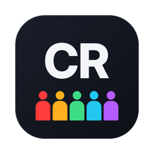
</p>

<h1 align="center">Crew Link</h1>

<p align="center">
  <b>Ablauf der Nacht: wer wann spielt, Countdown bis Set-Ende und Sperrstunde – eine Uhr für alle.</b><br>
  Ein Rechner hält den Timetable. Booth, DJs, Technik, Security und Bar sehen ihn im Browser – ohne Installation.
</p>

<p align="center">
  <a href="#download"></a>
</p>

<p align="center">
  
  
  
  <a href="https://github.com/skyplayser/Crew-Link/releases"></a>
  <a href="LICENSE"></a>
</p>

<p align="center">
  <a href="https://skyplayser.github.io/Crew-Link/de/">Website</a> &nbsp;·&nbsp;
  <a href="#download">Download</a> &nbsp;·&nbsp;
  <a href="#schnellstart">Schnellstart</a> &nbsp;·&nbsp;
  <a href="#teil-der-link-suite">Link-Suite</a> &nbsp;·&nbsp;
  <a href="https://discord.gg/N6DMca4Bjk">Discord</a> &nbsp;·&nbsp;
  <a href="README.md">English</a>
</p>

<p align="center">
  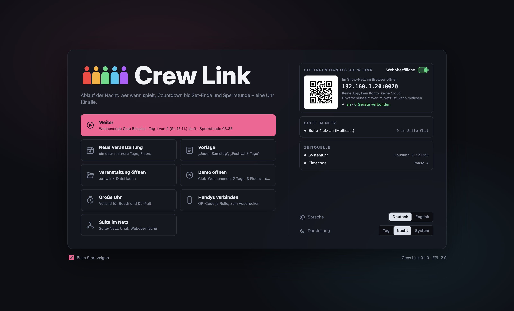
  <br><sub>Startbildschirm mit der Demo-Veranstaltung. Die Adresse 192.168.1.20 ist ein Beispiel.</sub>
</p>

Eine Clubnacht hat viele Uhren: den Laptop des DJs, die Booth, die Kasse an der Bar, das Handy am Einlass. Selten zeigen
sie dasselbe, und der Ablauf hängt auf einem Zettel, den an der Bar keiner gesehen hat. **Crew Link bringt die Nacht an
einen Ort.** Die Leitung legt den Timetable auf einem Rechner im Show-Netz an – dem **Leitstand** –, für eine Clubnacht
oder ein Festival mit mehreren Tagen und Floors. Alle anderen öffnen ihn im Browser auf Handy und Tablet, als große Uhr in
der Booth oder auf einem Bildschirm am Eingang. Alle zeigen dieselbe Zeit, auch wenn die Uhren der Geräte falsch gehen.

Crew Link zeigt nur Zeiten. **Es stoppt keine Musik und schaltet kein Licht.**

> [!WARNING]
> **Das ist die erste öffentliche Alpha (0.1.0, Phase 1 des Plans).** Geprüft ist sie nur im Demo-Modus auf dem
> Prüfrechner (ein Mac) und mit mehr als 100 automatischen Tests. Der Test mit echten Handys und Tablets steht noch aus;
> Windows und eine echte Clubnacht sind ebenfalls nicht getestet.
> Die App ist nicht signiert und nicht notarisiert. Installiert wird sie über den **Launcher Link-Suite**
> ([Download](#download)). Probier sie vor einer wichtigen Nacht aus, halte einen Ausdruck bereit und erzähl uns auf
> [Discord](https://discord.gg/N6DMca4Bjk), was dir auffällt.

## Highlights

<table>
<tr>
<td width="50%" valign="top">

**🗓️ Timetable mit Tagen und Floors**<br>
Eine Veranstaltung mit einem oder mehreren Tagen, jeder mit Betriebszeit und eigener Sperrstunde. Floors mit Farben,
Slots in der Zeitleiste oder als Liste. *Tag kopieren* nimmt das Raster in die nächste Nacht mit. Die Prüfung zeigt
Überschneidungen, Slots nach der Sperrstunde und die Zeitumstellung.

</td>
<td width="50%" valign="top">

**⏱️ Countdowns, die nicht springen**<br>
Set-Ende, nächster Slot, Floor-Ende und Sperrstunde – grün, ab 10 min gelb, ab 2 min rot, danach rot mit „+“, wenn ein
DJ überzieht. Ziffern mit fester Breite, lesbar quer durch die Booth.

</td>
</tr>
<tr>
<td valign="top">

**📱 Handys ohne App**<br>
*Handys verbinden* schaltet die Weboberfläche ein und zeigt je Rolle einen QR-Code: Leitung, Booth, DJ, Technik,
Security, Bar. Jede Rolle sieht, was sie braucht – der DJ „Du spielst in 12:03“, die Bar „Letzte Runde“, die Security
„Einlassstopp“.

</td>
<td valign="top">

**🕐 Eine Hausuhr**<br>
Der Leitstand gibt die Zeit vor. Browser messen ihre Abweichung über die Verbindung – auch ein Handy mit falscher Uhr
zählt richtig, auf dem Prüfrechner auf etwa ±0,01 s.

</td>
</tr>
<tr>
<td valign="top">

**🔴 Große Uhr für Booth und DJ-Pult**<br>
Vollbild, ein Floor: Countdown bis Set-Ende, wer danach kommt, ein Balken bis zur Sperrstunde. Als eigenes Fenster am
Leitstand oder im Browser. Nur öffentliche Namen.

</td>
<td valign="top">

**🚪 Öffentliche Seite für den Eingang**<br>
„Jetzt · danach“ je Floor und die Uhrzeit, für einen Bildschirm am Einlass oder an der Bar. Nur öffentliche Namen – ein
Secret Guest bleibt „Special Guest“. Keine Notizen, keine Übergabe-Zeiten.

</td>
</tr>
<tr>
<td valign="top">

**📶 Zählt weiter ohne Netz**<br>
Fällt das WLAN aus, zählen Handys und Uhren mit dem letzten Plan weiter und zeigen einen gelben Streifen: „Keine
Verbindung seit 0:13 – Zeiten laufen weiter“.

</td>
<td valign="top">

**🔒 Nichts gespeichert ohne Frage**<br>
Crew Link fragt, bevor es eine Veranstaltung auf dem Rechner sichert. Ohne Ja bleibt der Plan nur im Speicher.
Browser-Seiten speichern nichts – keine Cookies, kein Konto, keine Cloud.

</td>
</tr>
<tr>
<td valign="top">

**🔀 Überzogen? Du entscheidest**<br>
*Nächsten kürzen* und *Alles verschieben* zeigen erst eine Vorschau und ändern nichts, bis du bestätigst. Crew Link warnt,
wenn eine Verschiebung über die Sperrstunde geht. Von selbst ändert es den Plan nie.

</td>
<td valign="top">

**💬 Suite-Chat mit EMERGENCY**<br>
Am Leitstand ist Crew Link ein normaler Teilnehmer im Suite-Chat mit LJ Link, LJL Link und VJ-Link – ohne Server.
EMERGENCY ist kein Sicherheitssystem.

</td>
</tr>
</table>

| | |
|---|---|
| 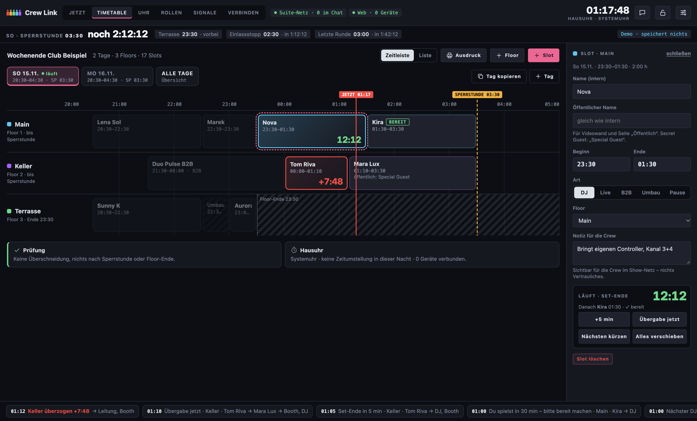 | 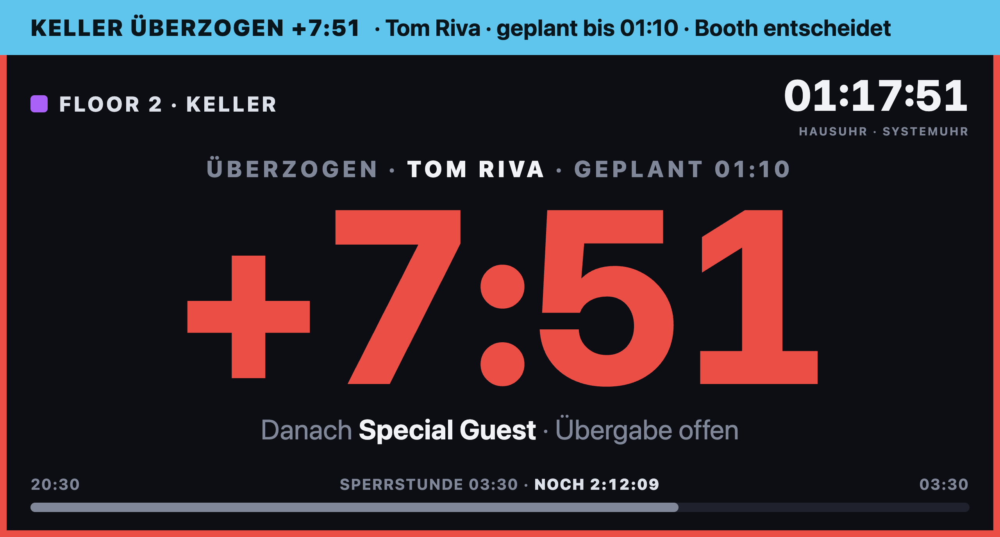 |
| **TIMETABLE.** Drei Floors; die rote Linie ist jetzt, die gelbe die Sperrstunde. | **Große Uhr.** Das Set ist überzogen: rot mit „+“. |
| 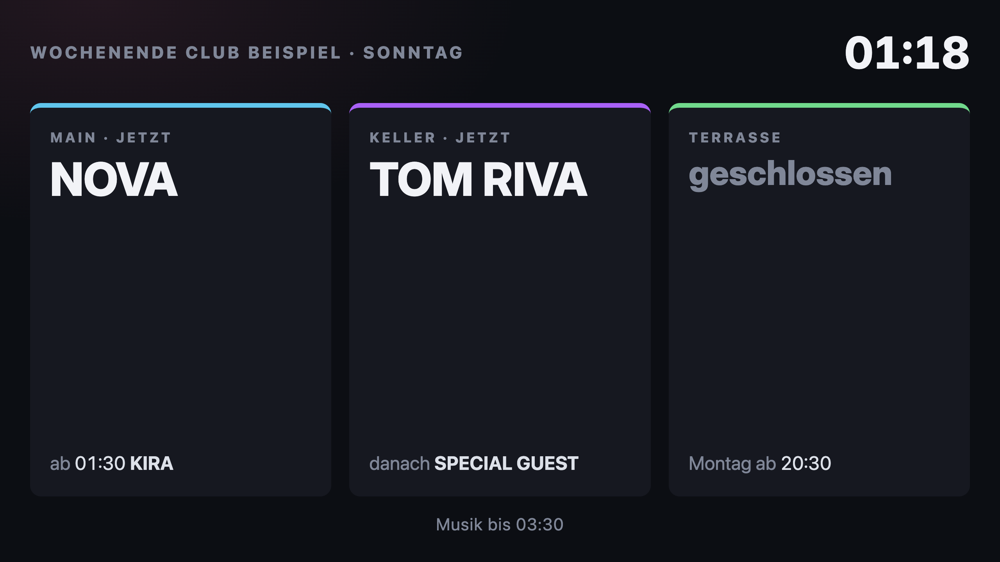 | 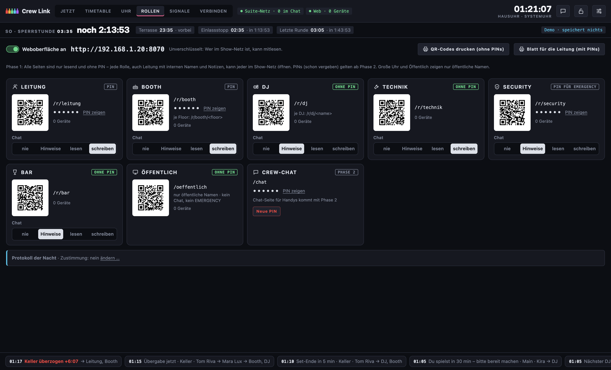 |
| **Öffentliche Seite** für den Eingang. Nur öffentliche Namen. | **ROLLEN.** Ein QR-Code je Rolle, zum Ausdrucken. |

<p align="center">
  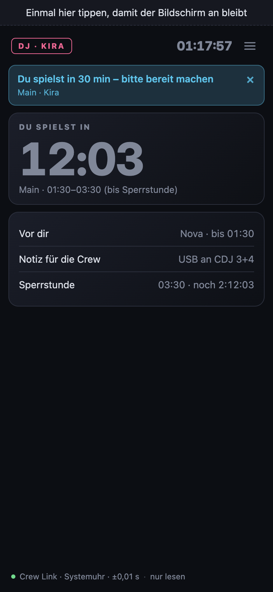
  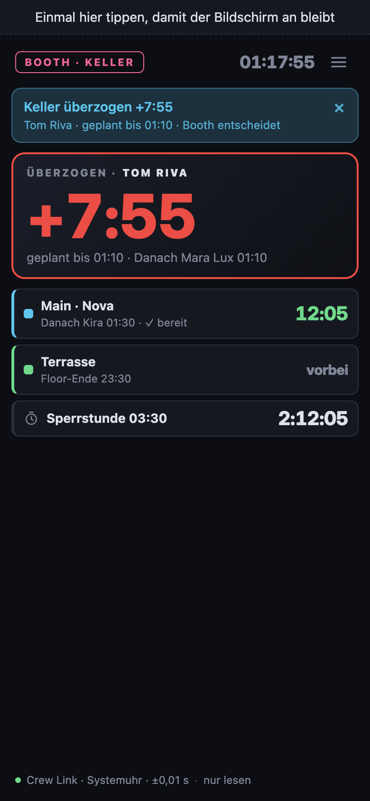
  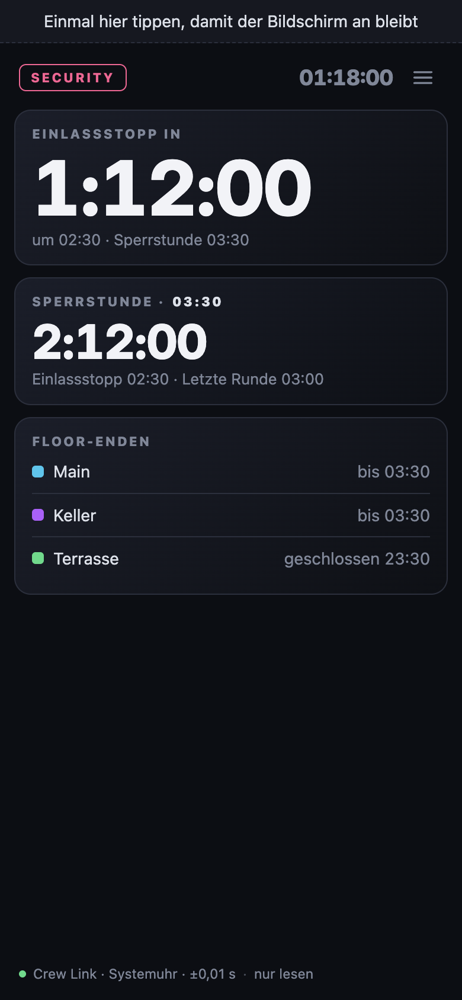
  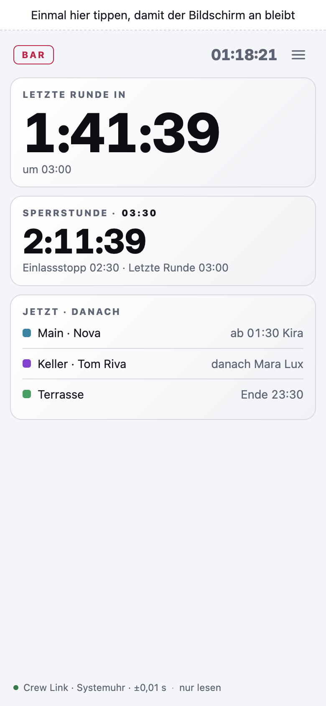
  <br><sub>Handy-Ansichten für DJ, Booth, Security und Bar – Demo-Daten, aufgenommen im Browser auf dem Mac.</sub>
</p>

## So funktioniert's

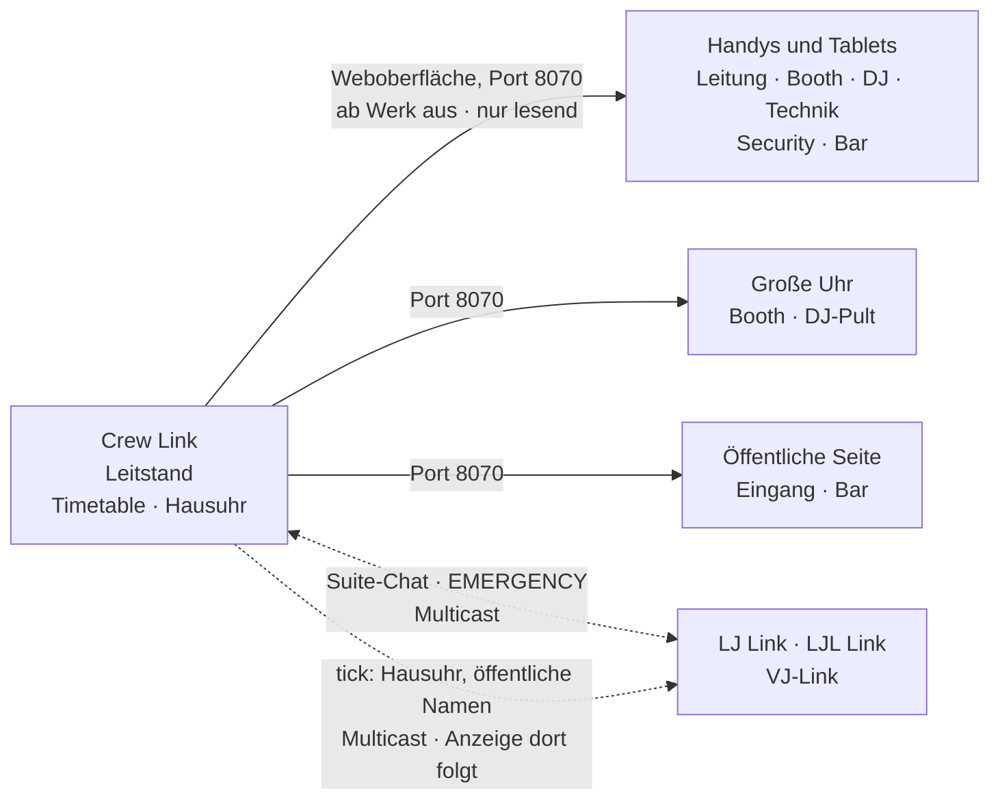

Alles bleibt im lokalen Netz: kein Konto, keine Cloud, keine Telemetrie. Crew Link 0.1.0 baut keine Verbindung ins
Internet auf. Der Countdown in LJ Link, LJL Link und VJ-Link ist geplant: Crew Link sendet ihn schon, die anderen
Programme zeigen ihn aber noch nicht an.

## Was den Rechner verlässt

Crew Link sendet nur im lokalen Netz. Es hat kein Konto, keine Cloud, keine Telemetrie und keine Update-Prüfung.

| Was | Wohin | Wann |
|---|---|---|
| Rollen-Seiten: Timetable mit internen Namen und Notizen (Leitung, Booth, DJ, Technik, Security, Bar) | Browser im Show-Netz, Port 8070, unverschlüsselt | nur bei eingeschalteter Weboberfläche (ab Werk aus) |
| Große Uhr und öffentliche Seite: nur öffentliche Namen, keine Notizen | Browser, Port 8070 | nur bei eingeschalteter Weboberfläche |
| `here` alle 5 s: Programm, Version, Rolle, Web-Adresse, Kennung der Veranstaltung, Tag | Suite-Netz (Multicast 239.255.76.76:47676, TTL 1) | solange das Suite-Netz an ist (ab Werk an, abschaltbar unter VERBINDEN) |
| `tick` jede Sekunde: Hausuhr, laufender Tag, Floors **nur mit öffentlichen Namen** | Suite-Netz | solange das Suite-Netz an ist |
| Suite-Chat: alle 5 s ein Anwesenheitszeichen (Programm, zufällige Kennung, dein Chat-Name und deine Position); jede Nachricht mit Name, Position, Text und Uhrzeit. Neue im Raum bekommen von jedem Programm, auch von Crew Link, die letzten bis zu 20 Nachrichten noch einmal. Absender lassen sich fälschen. | alle Suite-Programme im Netz (Multicast, unverschlüsselt) | solange das Suite-Netz an ist |
| *In NET Link prüfen* öffnet NET Link auf demselben Rechner (`netlink://`) | nur dieser Rechner | nur wenn du darauf klickst |
| Aufruf der Link-Suite-Website (`https://skyplayser.github.io/Link-Suite/`) | dein Browser | nur wenn du auf der Karte im Startbildschirm „Link-Suite laden“ klickst |
| Telefonnummern, E-Mails, Gagen | – | nie: Crew Link hat dafür keine Felder |

Die Weboberfläche antwortet nur Geräten aus privaten Adressbereichen (10/8, 172.16/12, 192.168/16, 169.254/16, 127/8).

Die Karte „Alle Programme an einem Ort“ im Startbildschirm erscheint nur, wenn der Launcher Link-Suite nicht installiert
ist. Die Prüfung ist lokal: Crew Link schaut nur, ob es `Link-Suite.app` (macOS) bzw. `Link-Suite.exe` und den
Deinstallations-Eintrag (Windows) auf diesem Rechner gibt. Es wird nichts gesendet, gezählt oder geschrieben – bis du auf
„Link-Suite laden“ klickst. „Nicht mehr zeigen“ steht als Programm-Einstellung in `prefs.json` (`hideLauncherHint`). Nie
in der Demo, nie während eine Nacht läuft, nie auf der großen Uhr oder den Browser-Seiten.

## Datenschutz

- **Sichern nur mit deinem Ja.** Beim Anlegen fragt Crew Link *Auf diesem Rechner sichern?* Ohne Ja bleibt der Plan nur
  im Speicher – kein Autosave, keine Liste zuletzt geöffneter Dateien. Nach einem Absturz ist er weg; das sagt die Frage
  ehrlich. Die Demo speichert nie.
- **Einstellungsdatei nur bei Bedarf.** `prefs.json` entsteht nur, wenn eine Einstellung vom Standard abweicht.
- **Die Browser-Seiten von Crew Link speichern nichts:** keine Cookies, kein localStorage, kein Konto. Die Rolle steckt in der Adresse.
- **Öffentlicher Name je Slot.** Öffentliche Seite, große Uhr und Suite-Netz bekommen nur den öffentlichen Namen. Secret
  Guests bleiben geheim.
- **Unverschlüsselt.** Wer im Show-Netz ist, kann den Plan lesen. Das Notiz-Feld sagt es dazu: „Sichtbar für die Crew im
  Show-Netz – nichts Vertrauliches.“
- Chat-Nachrichten nur im Speicher, nie in einer Datei – sie gehen aber an alle Programme im Raum und können an Neue
  weitergegeben werden (siehe Tabelle oben).

## Download

<a href="https://skyplayser.github.io/Link-Suite/">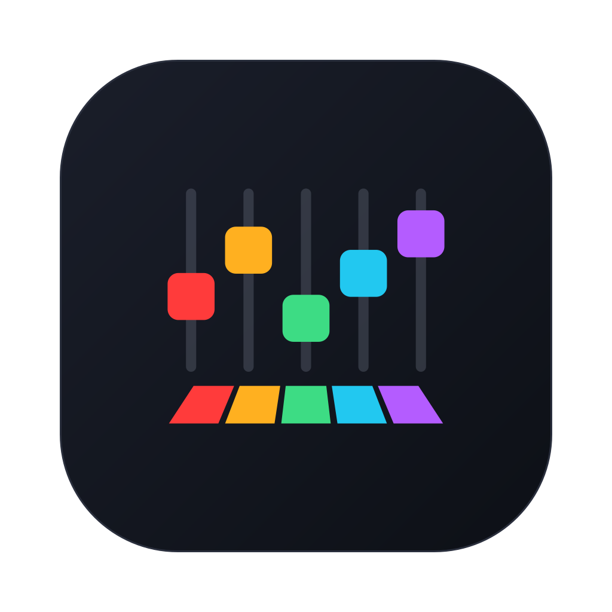</a>

Alle Programme der Suite lädst und installierst du mit einem Launcher: **Link-Suite**, für Mac und Windows.

<br clear="left">

| System | Launcher |
|---|---|
| macOS, Apple Silicon | [Link-Suite-macos-arm64.dmg](https://github.com/skyplayser/Link-Suite/releases/latest/download/Link-Suite-macos-arm64.dmg) |
| macOS, Intel | [Link-Suite-macos-intel.dmg](https://github.com/skyplayser/Link-Suite/releases/latest/download/Link-Suite-macos-intel.dmg) |
| Windows | [Link-Suite-windows.exe](https://github.com/skyplayser/Link-Suite/releases/latest/download/Link-Suite-windows.exe) |

Mehr zum Launcher: [skyplayser.github.io/Link-Suite](https://skyplayser.github.io/Link-Suite/).

Öffne den Launcher und klick neben Crew Link auf *Installieren*. Der Launcher lädt Crew Link aus den Releases dieses
Repos, prüft die Datei und hält alle Programme der Suite aktuell. Crew Link braucht Link-Suite **1.0.5 oder neuer**; zeigt der
Launcher Crew Link noch als *kommt bald*, aktualisiere zuerst den Launcher.

<sub>Einzelne Installer von Crew Link (`Crew-Link-macos-arm64.dmg`, `Crew-Link-macos-intel.dmg`, `Crew-Link-windows.exe`) und `SHA256SUMS` liegen in den [GitHub-Releases](https://github.com/skyplayser/Crew-Link/releases) dieses Repos.</sub>

Der Launcher und Crew Link 0.1.0 sind **noch nicht signiert und nicht notarisiert**. Beide Systeme können deshalb beim
ersten Start warnen:

- **macOS** („nicht geöffnet“): auf *Fertig* klicken, *Systemeinstellungen → Datenschutz & Sicherheit* öffnen, nach
  unten scrollen, **Dennoch öffnen** klicken und mit dem Passwort bestätigen. Den Zugriff aufs lokale Netzwerk erlauben,
  wenn macOS fragt – sonst erreichen Handys und Suite-Chat Crew Link nicht.
- **Windows** („Der Computer wurde durch Windows geschützt“): **Weitere Informationen**, dann **Trotzdem ausführen**.
  Fragt die Firewall, *Private Netzwerke* erlauben, sonst erreichen die Handys die Weboberfläche nicht.

Mach das nur mit Dateien, die du von dieser GitHub-Seite oder der offiziellen Website geladen hast.

## Schnellstart

1. **Crew Link installieren** über den Launcher Link-Suite ([Download](#download)). Oder aus dem Quellcode:
   `git clone https://github.com/skyplayser/Crew-Link.git && cd Crew-Link && npm install && npm start -- --demo`
   (Node.js 22 oder neuer, Einzelheiten unter [Selbst bauen](#selbst-bauen)).
2. **Demo ansehen** (*Demo öffnen* im Startbildschirm). Sie speichert nichts. Auf *Main* läuft ein Set, im *Keller* überzieht ein DJ, die Terrasse ist zu,
   die Sperrstunde ist in etwa zwei Stunden.
3. **Handys verbinden.** Klick auf *Handys verbinden*. Der Startbildschirm zeigt die Adresse (z. B.
   `http://192.168.1.20:8070/`) und einen QR-Code; unter ROLLEN gibt es einen QR-Code je Rolle. Die Handys müssen im
   selben Netz sein wie der Leitstand.
4. **Deine Nacht.** *Neue Veranstaltung*: Name, Tage, Betriebszeit, Sperrstunde, Floors – dann Slots in die Zeitleiste
   ziehen.
5. **In der Nacht:** Der Tab JETZT zeigt alle Floors mit großen Countdowns; *Große Uhr* öffnet ein Vollbild-Fenster für
   einen zweiten Bildschirm.

Gib die Weboberfläche nur im Show-Netz oder in einem eigenen Crew-WLAN frei, nie im Gäste-WLAN (siehe
[Sicherheit](#sicherheit)).

## Was in 0.1.0 läuft – und was noch nicht

| Bereich | Stand |
|---|---|
| Timetable: Tage, Floors, Slots, Zeitleiste, Liste, Tag kopieren, Vorlagen, Prüfung, Ausdruck A4 | Alpha · geprüft im Demo-Modus und mit automatischen Tests |
| Countdowns, Sperrstunde je Tag, nächster Tag, Tab JETZT | Alpha · geprüft im Demo-Modus |
| Zeitzone, Mitternacht, Zeitumstellung (letzter Sonntag im März und Oktober) | 13 Fälle als Tests, dazu Gegenprüfung mit einer zweiten Zeit-Bibliothek |
| Weboberfläche, Rollen-Seiten, große Uhr, öffentliche Seite, QR-Codes | Alpha · geprüft im Browser auf demselben Mac, **noch nicht auf echten Handys oder Tablets** |
| Bildschirm bleibt an (Wake Lock, Video-Notbehelf aus LJ Link) | Notbehelf über http, **auf echten Geräten ungetestet**. Am Netzteil „Automatische Sperre: Nie“ einstellen |
| Suite-Netz und Suite-Chat | geprüft auf einem Mac neben VJ-Link auf einem Testport; nicht zwischen zwei Rechnern, nicht im Club |
| Windows | **nicht getestet** |
| Download über den Launcher Link-Suite | ab Release 0.1.0 |
| Signierte und notarisierte App | **noch nicht** – macOS und Windows können beim ersten Start warnen |
| PINs und Rechte, Knöpfe am Handy (*Bereit*, *+5 min*) | noch nicht (Phase 2) – in 0.1.0 sind alle Browser-Seiten **nur lesend und ohne PIN** |
| Crew-Chat und EMERGENCY auf Handys, Bonjour | noch nicht (Phase 2) |
| Protokoll der Nacht | noch nicht (Phase 3) |
| Signale, Saallicht, Timecode als Zeitquelle | noch nicht (Phase 4) |
| Countdown in LJ Link, LJL Link, VJ-Link | noch nicht – die Programme brauchen erst ein Update |
| Bühnen (Festival) | im Dateiformat, noch ohne Oberfläche (Phase 5) |

## Sicherheit

- **Keine PIN in 0.1.0.** Wer Port 8070 erreicht, kann jede Rolle öffnen, auch die Seite der Leitung mit internen Namen
  (Secret Guests) und Notizen. Die PINs gibt es schon, geprüft werden sie erst ab Phase 2. Schalte die Weboberfläche
  deshalb nur im Show-Netz oder in einem eigenen Crew-WLAN mit Passwort ein – **nie im Gäste-WLAN**.
- Die Weboberfläche ist **ab Werk aus**. An ist sie nur, wenn die Leitung *Handys verbinden* wählt.
- **Unverschlüsselt:** Im Show-Netz gibt es kein HTTPS – wie bei Art-Net, OSC und dem Suite-Chat.
- Der Webserver nimmt nur GET/HEAD an, prüft Host und Origin, liefert eine feste Liste von Dateien, und seine Seiten laden
  nichts von außen. Ist Port 8070 belegt, sagt Crew Link das und weicht nicht auf einen anderen Port aus (gedruckte
  QR-Codes bleiben gültig).
- Zwei Leitstände im Netz: Crew Link warnt, es gilt der erste.

> [!IMPORTANT]
> Die Sperrstunde in Crew Link ist die Zeit, die du eingibst. Crew Link kennt und prüft keine Auflagen, Genehmigungen
> oder Sperrzeiten – dafür bleibt der Veranstalter verantwortlich.
>
> EMERGENCY und Crew Link sind **kein Alarm- oder Sicherheitssystem**. Sie ersetzen keine Durchsagen, Funkgeräte,
> Brandmeldeanlage oder das Sicherheitskonzept der Veranstaltung. Nachrichten können verloren gehen oder spät kommen,
> und jeder im selben Netz kann sie senden. Software, Netz und Geräte können ausfallen – der Ausdruck gehört an die Wand.

## Teil der Link-Suite

<p>
  <picture>
    <source media="(prefers-color-scheme: dark)" srcset="docs/images/link-suite-logo-on-dark.svg">
    
  </picture>
</p>

Crew Link gehört zur **Link-Suite**: kostenlose Programme für Veranstaltungstechnik, die zuhören statt steuern, keinen
Server brauchen und im lokalen Netz bleiben. Sie teilen Suite-Chat, EMERGENCY und dieselben Begriffe – Show-Netz, Booth,
Suite-Chat.

<a href="https://github.com/skyplayser/LJ-Link">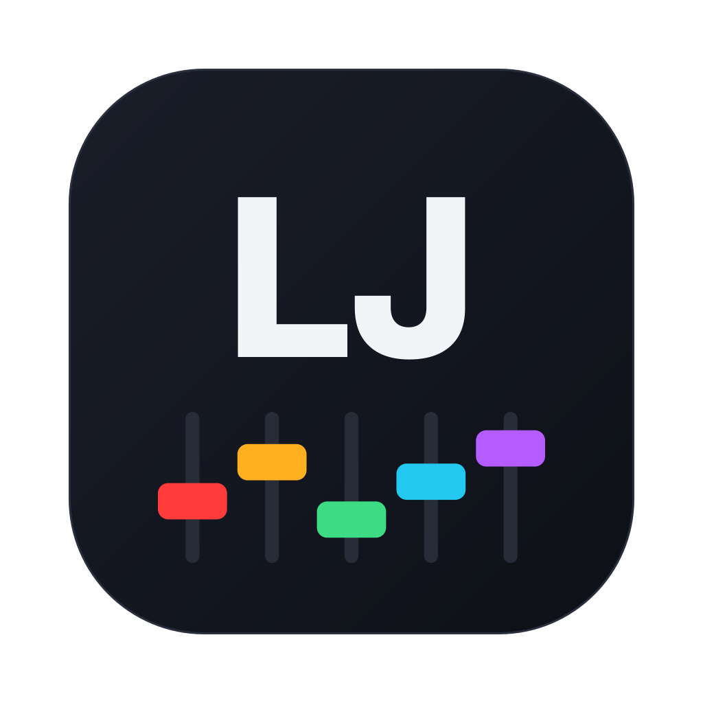</a>

**[LJ Link](https://github.com/skyplayser/LJ-Link)** zeigt dem Lightjockey, was der DJ spielt: jedes Deck, Wellenform, Cue
und BPM von Pioneer- und Denon-Geräten, und schickt das Tempo an grandMA, Daslight und mehr. Kostenlos für macOS und
Windows.

<br clear="left">

<a href="https://github.com/skyplayser/LJL-Link">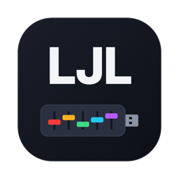</a>

**[LJL Link](https://github.com/skyplayser/LJL-Link)** bringt die Serato-Decks vom Mac des DJs in LJ Link – direkt vom
USB-Stick des Clubs, ohne Installation. Alpha für macOS.

<br clear="left">

<a href="https://github.com/skyplayser/VJ-LINK">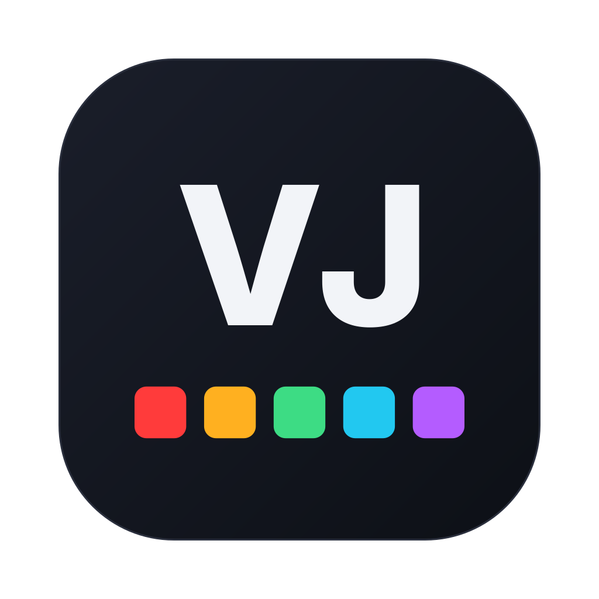</a>

**[VJ-Link](https://github.com/skyplayser/VJ-LINK)** spielt Live-Visuals, gesteuert vom Lichtpult, auf Bildschirmen,
LED-Wänden und Projektoren, und nimmt Tempo und Titel aus LJ Link. Kostenlos für macOS und Windows.

<br clear="left">

<a href="https://github.com/skyplayser/VD-Link">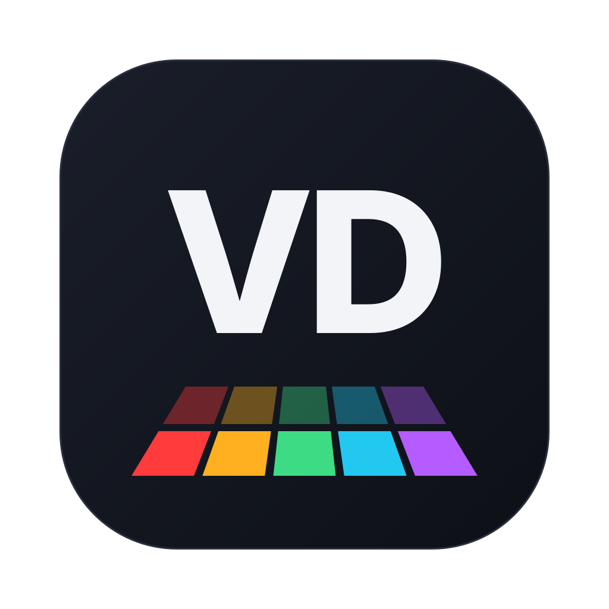</a>

**[VD-Link](https://github.com/skyplayser/VD-Link)** ist ein 3D-Lichtvisualisierer für Art-Net und sACN: Dein Lichtpult
steuert einen virtuellen Club oder ein Festival, und du siehst die Show, bevor sie hängt. Kostenlos für macOS und Windows.

<br clear="left">

**In Arbeit:** PL Link (Patch und Stromlast für Locations), NET Link (wer ist im Show-Netz, und was stimmt dort nicht) und
dB Link (Lautstärke messen, warnen, protokollieren). Noch nicht veröffentlicht.

## Selbst bauen

Programm der Link-Suite, Electron + TypeScript, Lizenz **EPL-2.0**. Stand: **0.1.0 = MVP (Phase 1 des Konzepts)**.
Muster: [`design/`](design/).

### Starten

Node 22 oder neuer.

```sh
npm install
npm run check          # Typprüfung + Tests (vitest)
npm run build          # Bau nach dist/
npm start              # bauen und starten
npm start -- --demo    # mit Demo-Veranstaltung (zwei Tage, drei Floors, relativ zur aktuellen Zeit)
```

Lädt `npm install` das Electron-Programm nicht mit, holt `npm start` es beim ersten Start einmal nach.

#### Startoptionen

| Option | Wirkung |
|---|---|
| `--demo` | Demo „Wochenende Club Beispiel“: auf Main läuft ein Set (gut 10 min übrig, Kira bereit), im Keller ist ein Set überzogen, die Terrasse hat ihr Floor-Ende hinter sich, Sperrstunde in ca. 2 h. Speichert nichts. |
| `--web-on` | Weboberfläche gleich einschalten (sonst ab Werk aus). |
| `--port <n>` | Port der Weboberfläche für die Demo (Standard 8070). |
| `--lang de\|en` | Sprache erzwingen. |
| `--no-intro`, `--no-anim` | ohne Startanimation. |
| `--intro=<ms>[,<ms>…]` | nur mit `--shot` (zeigt sonst nie eine Animation): Bildfolge der Startanimation (Standbilder über `holdAt` des gemeinsamen Bausteins), Nacht und Tag, dazu „Bewegung reduzieren“, Endzustand und die Landung im Kopf-Logo bei abgewähltem Startbildschirm; danach beenden. Alias: `--intro-at <ms,…>`. Beispiel: `--shot shots/intro --intro=400,1000,1500,1900,2300,2600` |
| `--hint` | Karte „Link-Suite laden“ auch in Demo/Screenshots zeigen. |
| `--launcher=installed\|missing` | nur mit `--shot`: Launcher installiert/nicht installiert vortäuschen. |
| `--help` | Startoptionen anzeigen. |
| `--shot-address <ip>` | nur mit `--shot` oder `--demo`: zeigt in Startbildschirm, ROLLEN und QR-Codes diese IPv4-Adresse statt der echten (für veröffentlichte Bilder). Der Server bindet weiter echt. |
| `--shot <ordner>` | Screenshots für die QA, danach beenden (siehe unten). Schaltet Demo und Weboberfläche selbst ein. |

| Umgebung | Wirkung |
|---|---|
| `CREWLINK_DATA=<ordner>` | eigener Datenordner (Tests, QA). Dann auch mehrere Instanzen erlaubt und das Suite-Netz auf dem **Testport 47681**. |
| `CREWLINK_SUITE_PORT=<n>` | Port des Suite-Netzes erzwingen (echter Raum: 47676). |
| `CREWLINK_DEBUG=1` | Konsolenmeldungen der Oberfläche im Terminal. |

#### Screenshots für die QA

```sh
npm run build
CREWLINK_DATA=/tmp/crew-qa npx electron . --demo --web-on --shot /tmp/crew-shots
```

Erzeugt 68 PNGs (je Deutsch/Englisch × Nacht/Tag): Startbildschirm, TIMETABLE (Nova gewählt), JETZT, ROLLEN,
VERBINDEN, Fenster „Große Uhr“ für Main und Keller, und die Browser-Seiten über `http://127.0.0.1:<port>`:
Rolle wählen, Leitung, Booth Keller, DJ Kira, Technik, Security, Bar (390 × 844), große Uhr Main/Keller und
öffentliche Seite (1280 × 720). Liste in `LISTE.txt` im Ordner. Das Suite-Netz läuft dabei auf dem Testport 47681.

Die Weboberfläche der Demo ist mit `--demo --web-on` auf `http://127.0.0.1:8070/` erreichbar (bzw. `--port`):
`/`, `/r/leitung`, `/r/booth/keller`, `/r/dj/kira`, `/r/technik`, `/r/security`, `/r/bar`, `/uhr/main`,
`/oeffentlich`, `/oeffentlich?floor=main`; Darstellung per `?theme=day|night`, Sprache per `?lang=de|en`.

### Aufbau

| Ordner | Inhalt |
|---|---|
| `src/core/` | ohne Electron, ohne Netz, voll getestet: `zeit.ts` (Zeitzone nur mit `Intl`), `model.ts` (Veranstaltung, Tage, Floors/Bühnen, Slots, Datei `.crewlink`, Vorlagen), `countdown.ts` (laufender Tag, Floor-Zustand, Countdown-Zustände, Sperrstunden-Folge), `check.ts` (Prüfung), `shift.ts` („Nächsten kürzen“, „Alles verschieben“ als Vorschau), `clock.ts` (Hausuhr Leitstand und Browser), `plan.ts` (gefilterter Plan je Rolle, Hinweise), `net.ts` (Webserver-Prüfungen, `suite:"crew"` here/tick), `demo.ts`, `suitechat.ts` (aus VJ-Link), `i18n*.ts` |
| `src/main/` | Hauptprozess: `main.ts` (Fenster, IPC, Hausuhr, Startoptionen), `webserver.ts` (Port 8070, `node:http` + `ws`), `suitenet.ts` (Adapter mit der Schnittstelle von suite-net), `chatnet.ts` (Suite-Chat), `storage.ts` (Speichern nur mit Zustimmung), `shots.ts` (QA), `preload.ts` (schmale Brücke) |
| `src/renderer/` | Leitstand: Start, JETZT, TIMETABLE (Zeitleiste, Liste, Detailspalte), UHR, ROLLEN, SIGNALE, VERBINDEN, Dialoge, Ausdruck, Chat, Sperrmodus; `clock.ts` = Fenster „Große Uhr“ |
| `src/web/` | Browser-Seiten (eine Seite, liest den Pfad): Rollen, große Uhr, öffentliche Seite; `awake.ts` + `keep-awake-video.js` aus LJ Link |
| `src/shared/` | gemeinsam für Leitstand und Browser: Stile (`design/tokens.css`, `components.css` + `app.css`), Icons, große Uhr, Hinweis-Texte |
| `assets/` | Logos, Schrift (OFL), `intro/startanimation.html` (gemeinsamer Baustein der Suite) |
| `tests/` | vitest: Zeit (13 von Hand geprüfte Fälle + Gegenprüfung mit temporal-polyfill 2026–2030), Kern, i18n, Netz (Suite-Netz nur Port 47681, Webserver, Speichern) |

### Übergabe und Überziehen

- Je Veranstaltung „Übergabe: nach Plan“ (ab Werk) oder „bestätigen“ (Demo). Bei „bestätigen“ beginnt ein direkt
  folgender Slot erst mit **Übergabe jetzt**; bis dahin zählt der vorige mit „+mm:ss“ weiter. Ohne Bestätigung gilt
  spätestens ab dem früheren von Ende des nächsten Slots, Floor-Ende und Sperrstunde wieder der Plan; ab +15 min
  bekommen Leitung und Booth den Hinweis „Übergabe bestätigen?“. `tick` und öffentliche Seite folgen dem.
- „Nächsten kürzen“ / „Alles verschieben“ zeigen eine Vorschau und ändern erst nach „Bestätigen“ – bei „bestätigen“
  nur die folgenden Slots (Beginn = bestätigte bzw. erwartete Übergabe); das geplante Ende des überzogenen Slots bleibt,
  die tatsächliche Übergabe steht getrennt im Slot (`handover`).
- Zeitumstellung: Eine Uhrzeit in der fehlenden Stunde wird beim Eintippen abgelehnt. Beim Tag kopieren und bei
  Vorlagen bleibt jeder Slot erhalten: Beginn auf die erste gültige Zeit danach, gleiche Länge, gelbe Prüf-Karte
  „Zeit fiel in die Zeitumstellung – geprüft?“.

### Daten und Datenschutz

- Ohne Zustimmung („Auf diesem Rechner sichern?“ = Nein) schreibt Crew Link die Veranstaltung nicht auf die Platte –
  kein Autosave, keine Liste zuletzt geöffneter Dateien. Die Demo speichert nie.
- Mit Zustimmung: laufende Sicherung als `.crewlink` (atomar), Datei frei wählbar („Speichern unter …“), sonst im
  Datenordner unter `veranstaltungen/<kennung>.crewlink`; beim nächsten Start wird sie wieder geöffnet.
- `prefs.json` im Datenordner entsteht nur, wenn eine Einstellung vom Standard abweicht (Sprache, Darstellung,
  Startbildschirm, Startanimation, Suite-Netz) oder – nur mit Zustimmung – um den Pfad der zuletzt gesicherten
  Veranstaltung zu merken. Ohne Änderung gibt es keine `prefs.json`. Electron/Chromium legt im Datenordner eigene
  Cache-Dateien an (ohne Namen aus dem Plan).
- Eine geöffnete `.crewlink`, die mit eingeschalteter Weboberfläche gesichert wurde, schaltet sie nie von selbst ein:
  Crew Link fragt („Weboberfläche einschalten?“). Die eigene, zuletzt gesicherte Veranstaltung, die beim Start wieder
  geöffnet wird (z. B. nach einem Absturz), schaltet sie ohne Frage wieder ein, damit Handys und Uhren sofort zurück sind.
- `running.lock` im Datenordner: entsteht beim Start, wird beim sauberen Beenden gelöscht (nur Prozessnummer und Zeit,
  keine Namen). Liegt sie beim Start schon da, ist der letzte Lauf abgestürzt → keine Startanimation.
- Startanimation: gemeinsamer Baustein „Programm-Intro“ aus dem Suite-Launcher (`src/renderer/intro/`, unverändert).
  Der eigene Schalter (Einstellungen: Wie die Suite / An / Aus, gespeichert als `own.intro`) geht vor, sonst gilt
  `intro` aus `Link-Suite/suite.json` (nur gelesen). Nur einmal je Programmstart; nie auf der großen Uhr und den
  Browser-Seiten.
- Browser-Seiten speichern nichts (keine Cookies, kein localStorage). Name/Position im Suite-Chat nur im Speicher.

### Sicherheit (Phase 1)

- **Kein PIN in Phase 1:** Wer Port 8070 erreicht, kann jede Rolle öffnen, auch `/r/leitung` mit internen Namen
  (Secret Guests) und Notizen. Die PINs sind schon vergeben (Datei, Ausdruck für die Leitung), geprüft werden sie erst
  ab Phase 2.2. Deshalb: Weboberfläche nur im Show-Netz bzw. in einem eigenen Crew-WLAN, nie im Gäste-WLAN freigeben.
- Große Uhr (`/uhr/…` und Fenster) und `/oeffentlich` bekommen nur öffentliche Namen und keine Notizen; die
  öffentliche Seite nur den gezeigten und den folgenden Tag, keine Übergabe-Zeitpunkte und keine Hinweis-Einstellungen.
- Alles im Show-Netz ist unverschlüsselt (kein HTTPS). Je WebSocket höchstens 64 KB je Nachricht und 20 `ping` in 10 s.
- Zwei Leitstände im Netz: Crew Link hört fremde `here` mit `role:"lead"` und warnt im Kopf und unter VERBINDEN;
  es gilt, wer zuerst da war.

### Noch offen

- **Bühnen** (Festival, Konzept 1.1): im Datenmodell und in der Datei vorhanden, aber ohne Oberfläche zum Anlegen
  und Zuordnen – gehört zu Phase 5.5 (Festival-Extras).
- Signierung und Notarisierung, Test unter Windows (Phase 5.6), Test auf echten Handys und Tablets.
  Das Programm-Symbol (`assets/icon.png`) ist für Fenster und Dock
  gesetzt.
- PINs und Rechte, Crew-Chat-Seite, Bonjour `_crewlink._tcp` (Phase 2); Protokoll der Nacht (Phase 3, nur die
  Zustimmung wird gemerkt); Signale, Saallicht, Timecode (Phase 4); eigene Countdowns, Offline-Kopie im Browser, CSV-Import.

### Netz

- Weboberfläche: Port 8070, ab Werk aus; Port belegt → Meldung mit dem belegenden Programm (macOS, wenn erkennbar); nur
  Quelladressen aus 10/8, 172.16/12, 192.168/16, 169.254/16, 127/8; Host- und Origin-Prüfung; nur GET/HEAD; feste
  Dateitabelle; CSP ohne Fremdquellen. Port belegt → Meldung, kein Ausweich-Port. Phase 1: alle Seiten nur lesend.
- Suite-Netz: Multicast 239.255.76.76:47676, TTL 1, alle IPv4-Adapter, `reuseAddr`. Sendet `here` (alle 5 s, mit
  `ver`), `tick` (jede Sekunde, nur öffentliche Namen, nur laufender Tag), `bye`; beantwortet `probe` mit `echo`.
  Ab Werk an, abschaltbar unter VERBINDEN.

Änderungen je Version: [CHANGELOG.md](CHANGELOG.md) (Englisch). Fremdbestandteile und Lizenzen: [THIRD_PARTY.md](THIRD_PARTY.md).

## Danksagung und Hinweise

Große Ziffern und Logo-Schrift: [Inter](https://github.com/rsms/inter) (SIL Open Font License 1.1, siehe
[assets/fonts/Inter-OFL.txt](assets/fonts/Inter-OFL.txt)). QR-Codes mit uqr (MIT), WebSocket mit ws (MIT), auf Electron
(MIT). Gemeinsamer Code aus VJ-Link und LJ Link (gleicher Autor, EPL-2.0). Einzelheiten in [THIRD_PARTY.md](THIRD_PARTY.md).

Crew Link ist ein unabhängiges Projekt. Es ist kein offizielles Produkt von AlphaTheta / Pioneer DJ, inMusic / Denon DJ,
Serato, MA Lighting, Daslight, Artistic Licence oder anderen Herstellern von DJ-, Licht- oder Veranstaltungstechnik und
wird von ihnen nicht unterstützt; ebenso wenig von Apple, Google oder Microsoft. Apple, macOS, iPhone, iPad und
Bonjour sind Marken der Apple Inc.; CDJ ist eine Marke der AlphaTheta Corporation; Android ist eine Marke der Google LLC; Windows ist eine Marke der Microsoft Corporation. Alle Produktnamen und Marken gehören ihren Inhabern und werden nur genannt, um die
Kompatibilität zu beschreiben. Art-Net™ Designed by and Copyright Artistic Licence Holdings Ltd. Crew Link hat nichts mit
der Software LightJockey von Martin zu tun.

Crew Link ist kostenlos und ohne Gewährleistung. Es ist kein Alarm- oder Sicherheitssystem. Halte einen ausgedruckten
Timetable als Reserve bereit.

## Lizenz

© 2026 Philipp Spruck / NEXTPHILM. Crew Link steht unter der [Eclipse Public License 2.0](LICENSE), ohne Gewährleistung.
Die Haftung nach den gesetzlichen Vorschriften für Vorsatz und grobe Fahrlässigkeit, für Verletzungen von Leben, Körper
oder Gesundheit und nach dem Produkthaftungsgesetz bleibt unberührt.

<br>

<p align="center">
  <sub>Idee SKYPLAYSER/NEXTPHILM<br>
  Prompted with ❤️ made by Claude<br>
  <a href="https://skyplayser.github.io/Crew-Link/impressum.html">Impressum</a> ·
  <a href="https://skyplayser.github.io/Crew-Link/de/datenschutz.html">Datenschutzerklärung</a></sub>
</p>
