<p align="center">
  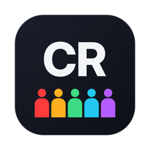
</p>

<h1 align="center">Crew Link</h1>

<p align="center">
  <b>Running order of the night: who plays when, countdown to set end and curfew – one clock for everyone.</b><br>
  One computer holds the timetable. Booth, DJs, tech, security and bar see it in the browser – nothing to install.
</p>

<p align="center">
  <a href="#download"></a>
</p>

<p align="center">
  
  
  
  <a href="LICENSE"></a>
</p>

<p align="center">
  <a href="https://skyplayser.github.io/Crew-Link/">Website</a> &nbsp;·&nbsp;
  <a href="#download">Download</a> &nbsp;·&nbsp;
  <a href="#quick-start">Quick start</a> &nbsp;·&nbsp;
  <a href="#part-of-the-link-suite">Link-Suite</a> &nbsp;·&nbsp;
  <a href="https://discord.gg/N6DMca4Bjk">Discord</a> &nbsp;·&nbsp;
  <a href="README.de.md">Deutsch</a>
</p>

<p align="center">
  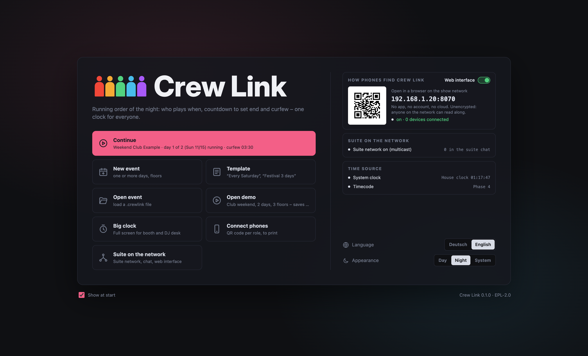
  <br><sub>Start screen with the demo event. The address 192.168.1.20 is an example.</sub>
</p>

A club night has many clocks: the DJ's laptop, the booth, the till at the bar, the phone at the door. They rarely agree,
and the running order lives on a sheet of paper nobody at the bar has seen. **Crew Link puts the night in one place.**
The lead builds the timetable on one computer in the show network – the **control desk** – for one night or a festival
with several days and floors. Everyone else opens it in the browser on a phone or tablet, as a big clock in the booth,
or on a screen at the entrance. All of them show the same time, even when the clocks of the devices are off.

It only shows times. **Crew Link never stops the music and never switches the light.**

> [!WARNING]
> **This is the first public alpha (0.1.0, phase 1 of the plan).** It has only been tested in demo mode on the test
> computer (one Mac) and with more than 100 automatic tests. The test with real phones and tablets is still to come;
> Windows and a real club night are not tested either. The app is not
> signed or notarized. Install it with the **Link-Suite launcher** ([Download](#download)). Try it before an important
> night, keep a printed timetable, and tell us what you find on [Discord](https://discord.gg/N6DMca4Bjk).

## Highlights

<table>
<tr>
<td width="50%" valign="top">

**🗓️ Timetable with days and floors**<br>
One event with one or more days, each with opening hours and its own curfew. Floors with colours, slots on a timeline
or as a list. *Copy day* takes the grid to the next night. The check marks overlaps, slots after curfew and the clock
change.

</td>
<td width="50%" valign="top">

**⏱️ Countdowns that do not jump**<br>
Set end, next slot, floor end and curfew – green, from 10 min yellow, from 2 min red, then red with “+” when a DJ runs
over. Fixed-width digits, readable across the booth.

</td>
</tr>
<tr>
<td valign="top">

**📱 Phones without an app**<br>
*Connect phones* switches on the web interface and shows a QR code per role: lead, booth, DJ, tech, security, bar. Each
role sees what it needs – the DJ “you play in 12:03”, the bar “last round”, security “entry stop”.

</td>
<td valign="top">

**🕐 One house clock**<br>
The control desk gives the time. Browsers measure their offset over the connection, so a phone with a wrong clock still
counts right – about ±0.01 s on the test computer.

</td>
</tr>
<tr>
<td valign="top">

**🔴 Big clock for booth and DJ desk**<br>
Full screen, one floor: the countdown to set end, who comes next and a bar to curfew. As its own window on the control
desk or in the browser. Public names only.

</td>
<td valign="top">

**🚪 Public page for the entrance**<br>
“Now · next” per floor and the time, for a screen at the door or the bar. Only public names – a secret guest stays
“Special Guest”. No notes, no handover times.

</td>
</tr>
<tr>
<td valign="top">

**📶 Keeps counting without network**<br>
If the Wi-Fi drops, phones and clocks keep counting with the last plan and show a yellow strip: “No connection for 0:13 –
times keep running.”

</td>
<td valign="top">

**🔒 Nothing stored without asking**<br>
Crew Link asks before it saves an event on the computer. Without a yes, the plan stays in memory only. Browser pages
store nothing – no cookies, no account, no cloud.

</td>
</tr>
<tr>
<td valign="top">

**🔀 Running over? You decide**<br>
*Shorten next* and *Shift everything* show a preview first and change nothing until you confirm. Crew Link warns when a
shift would go past curfew. It never changes the plan by itself.

</td>
<td valign="top">

**💬 Suite chat with EMERGENCY**<br>
On the control desk Crew Link is a normal member of the suite chat with LJ Link, LJL Link and VJ-Link – without a server.
EMERGENCY is not a safety system.

</td>
</tr>
</table>

| | |
|---|---|
| 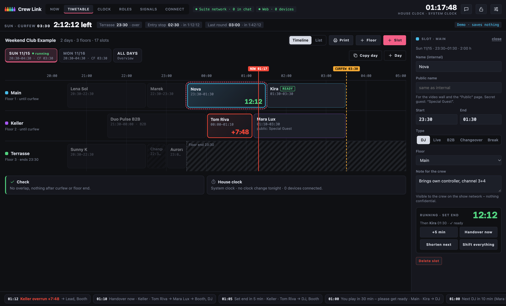 | 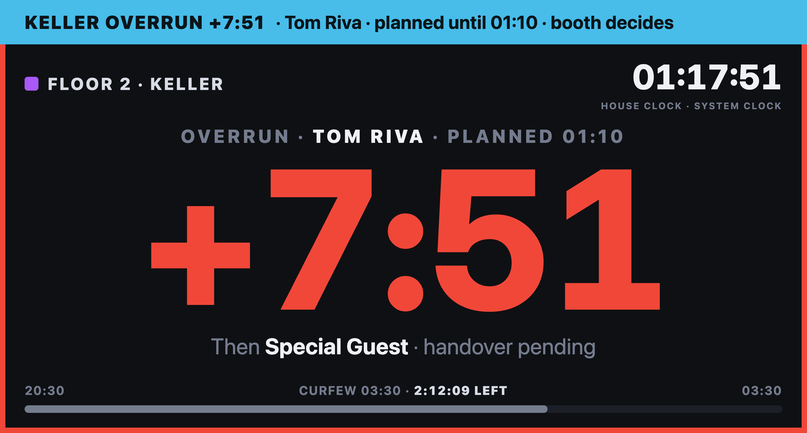 |
| **TIMETABLE.** Three floors; the red line is now, the yellow line is curfew. | **Big clock.** The set runs over: red with “+”. |
| 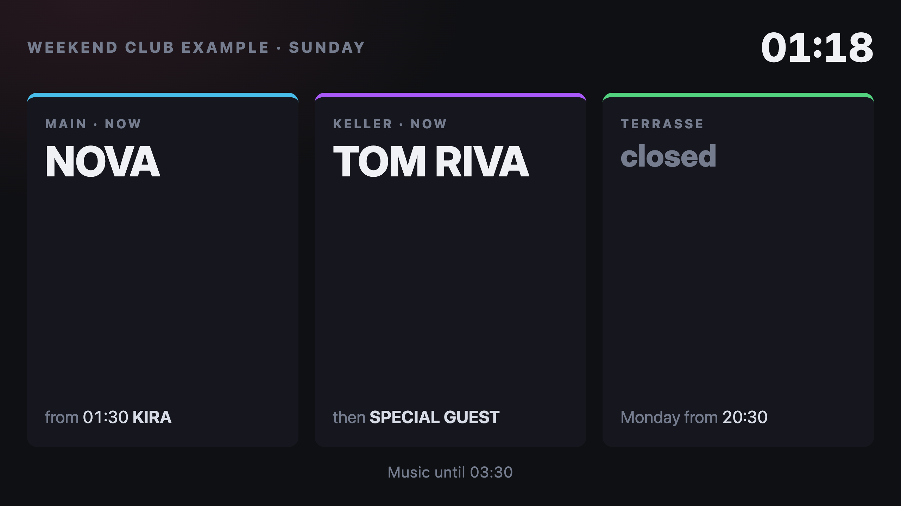 | 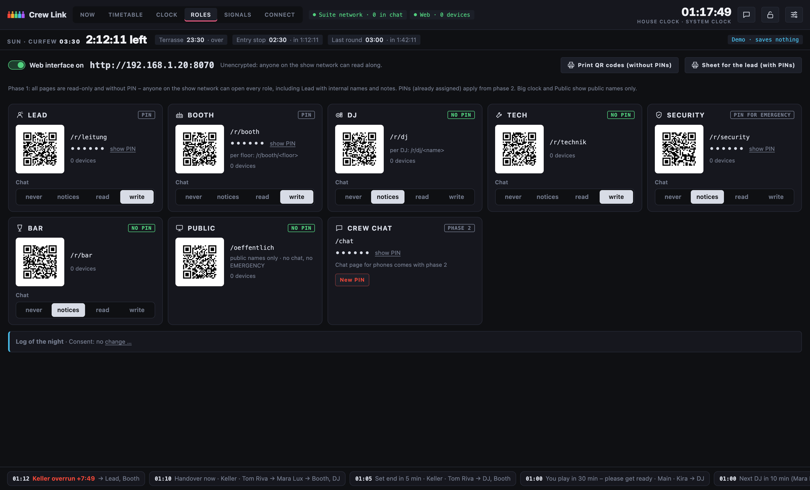 |
| **Public page** for the entrance. Public names only. | **ROLES.** One QR code per role, to print. |

<p align="center">
  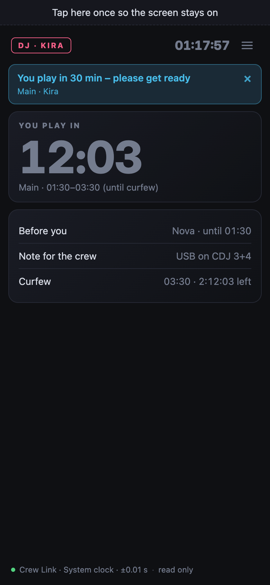
  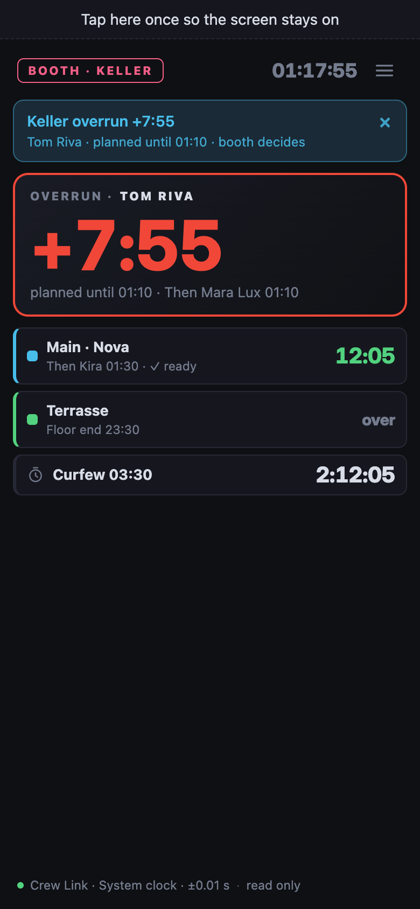
  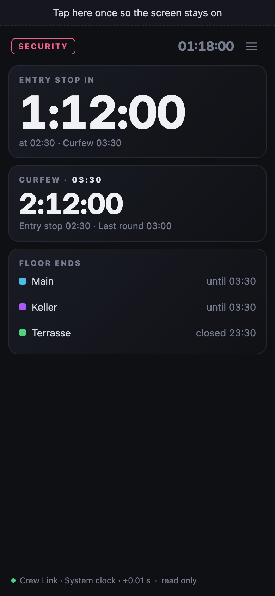
  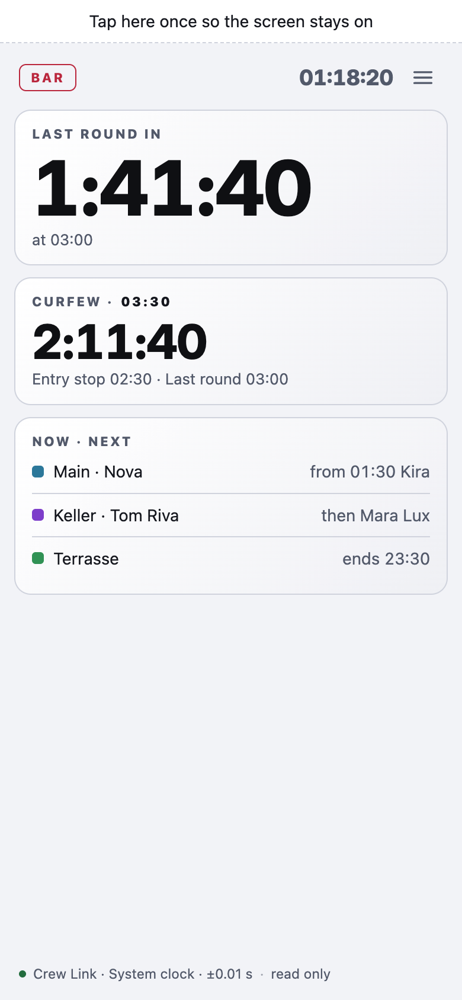
  <br><sub>Phone views for DJ, booth, security and bar – demo data, English interface, taken in a browser on the Mac.</sub>
</p>

## How it works

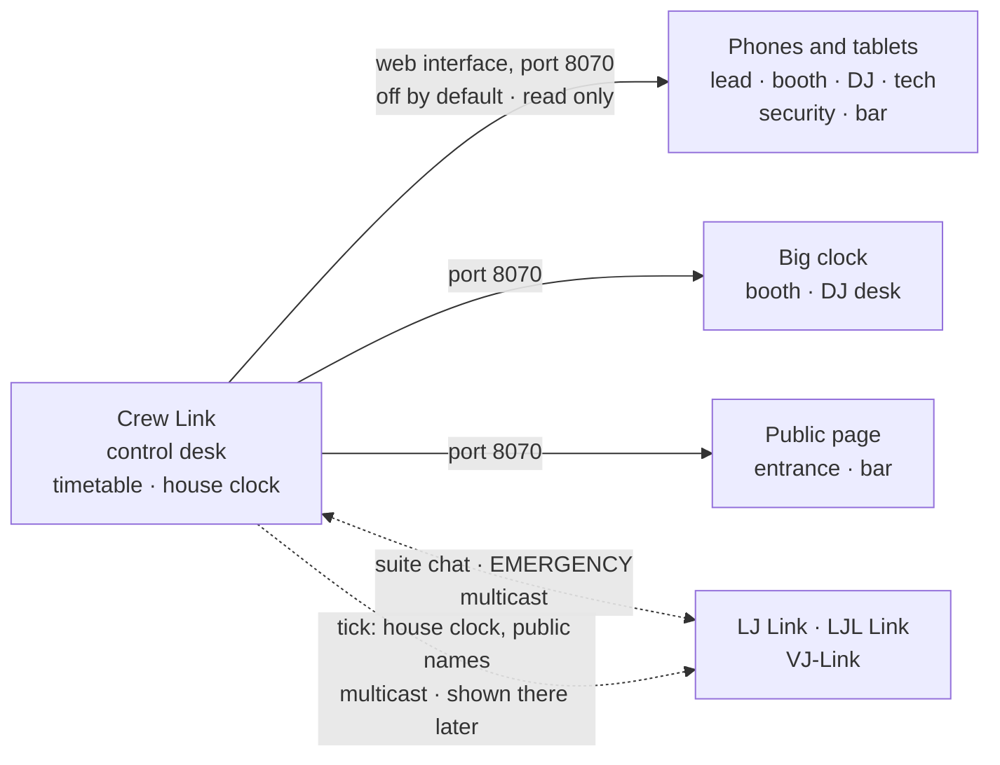

Everything stays in the local network: no account, no cloud, no telemetry. Crew Link 0.1.0 opens no connection to the
internet. The countdown inside LJ Link, LJL Link and VJ-Link is planned: Crew Link already sends it, but those programs do
not show it yet.

## What leaves your computer

Crew Link sends only within the local network. It has no account, no cloud, no telemetry and no update check.

| What | To | When |
|---|---|---|
| Role pages: timetable with internal names and notes (lead, booth, DJ, tech, security, bar) | browsers in the show network, port 8070, unencrypted | only while the web interface is on (off by default) |
| Big clock and public page: public names only, no notes | browsers, port 8070 | only while the web interface is on |
| `here` every 5 s: app, version, role, web address, event id, day | suite network (multicast 239.255.76.76:47676, TTL 1) | while the suite network is on (on by default, switch off under CONNECT) |
| `tick` every second: house clock, running day, floors with **public names** only | suite network | while the suite network is on |
| Suite chat: every 5 s a presence signal (program, random id, your chat name and position); each message with name, position, text and time. Newcomers get up to the last 20 messages again from every program in the room – also from Crew Link. Senders can be faked. | every suite program in the network (multicast, unencrypted) | while the suite network is on |
| *Check in NET Link* opens NET Link on the same computer (`netlink://`) | this computer only | only when you click it |
| Opening the Link-Suite website (`https://skyplayser.github.io/Link-Suite/`) | your browser | only when you click “Get Link-Suite” on the start screen card |
| Phone numbers, e-mails, fees | – | never: Crew Link has no fields for them |

The web interface only answers devices from private address ranges (10/8, 172.16/12, 192.168/16, 169.254/16, 127/8).

The card “All programs in one place” on the start screen appears only when the Link-Suite launcher is not installed. The
check is local: Crew Link only looks whether `Link-Suite.app` (macOS) or `Link-Suite.exe` and its uninstall entry
(Windows) exist on this computer. Nothing is sent, counted or written – until you click “Get Link-Suite”. “Don’t show
again” is stored as a program setting (`hideLauncherHint` in `prefs.json`). The card never appears in the demo, while a
night is running, on the big clock or on browser pages.

## Privacy

- **Saving only with your yes.** When you create an event, Crew Link asks *Save on this computer?* Without a yes, the plan
  is kept in memory only – no autosave, no list of recent files. After a crash it is gone; the question says so. The demo
  never saves.
- **Settings file only when needed.** `prefs.json` is only written when a setting differs from the default.
- **Crew Link's browser pages store nothing:** no cookies, no localStorage, no account. The role is in the address.
- **Public name per slot.** The public page, the big clock and the suite network get only the public name. Secret guests
  stay secret.
- **Unencrypted.** Anyone in the show network can read the plan. The notes field says so: “Visible to the crew on the
  show network – nothing confidential.”
- Chat messages are kept in memory only, never in a file – but they go to every program in the room and can be passed on
  to newcomers (see the table above).

## Download

<a href="https://skyplayser.github.io/Link-Suite/">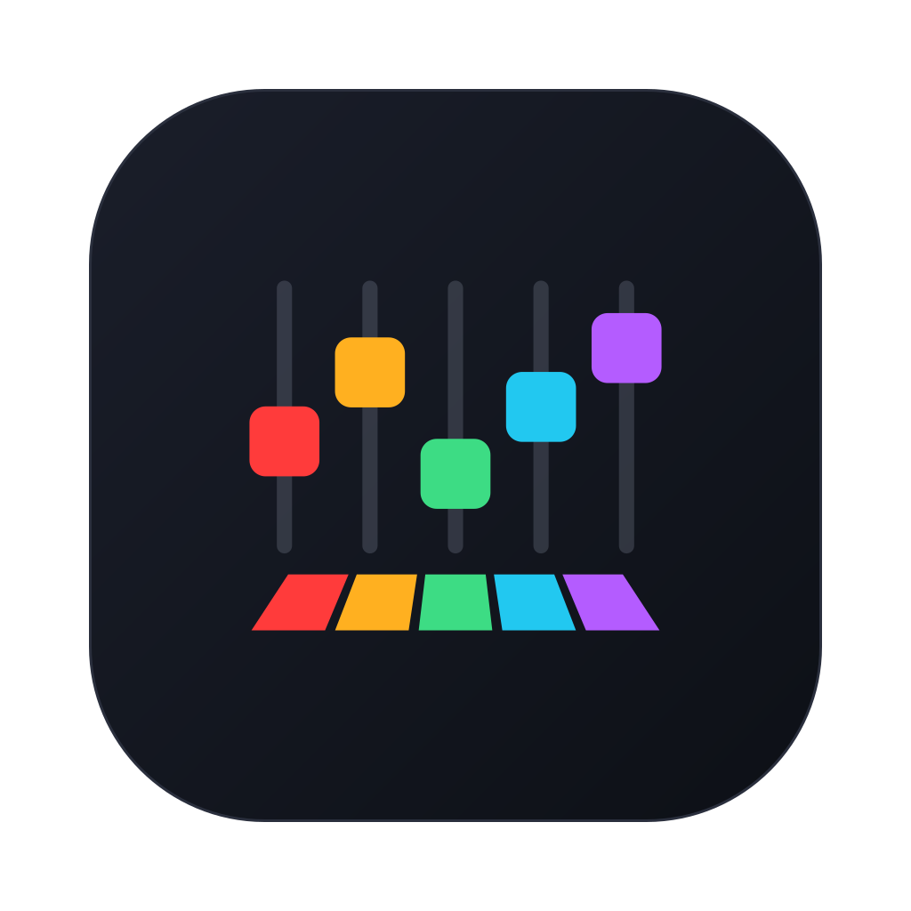</a>

All programs of the suite are downloaded and installed with one launcher: **Link-Suite**, for Mac and Windows.

<br clear="left">

| System | Launcher |
|---|---|
| macOS, Apple silicon | [Link-Suite-macos-arm64.dmg](https://github.com/skyplayser/Link-Suite/releases/latest/download/Link-Suite-macos-arm64.dmg) |
| macOS, Intel | [Link-Suite-macos-intel.dmg](https://github.com/skyplayser/Link-Suite/releases/latest/download/Link-Suite-macos-intel.dmg) |
| Windows | [Link-Suite-windows.exe](https://github.com/skyplayser/Link-Suite/releases/latest/download/Link-Suite-windows.exe) |

More about the launcher: [skyplayser.github.io/Link-Suite](https://skyplayser.github.io/Link-Suite/).

Open the launcher and click *Install* next to Crew Link. The launcher downloads Crew Link from this repository's
releases, checks the file and keeps all programs of the suite up to date. Crew Link needs Link-Suite **1.0.5 or newer**; if the launcher
still shows Crew Link as *coming soon*, update the launcher first.

<sub>Single installers of Crew Link (`Crew-Link-macos-arm64.dmg`, `Crew-Link-macos-intel.dmg`, `Crew-Link-windows.exe`) and `SHA256SUMS` are in this repository's [GitHub releases](https://github.com/skyplayser/Crew-Link/releases).</sub>

The launcher and Crew Link 0.1.0 are **not signed or notarized yet**, so both systems may warn on the first start:

- **macOS** (“Not Opened”): click *Done*, open *System Settings → Privacy & Security*, scroll down, click **Open Anyway**
  and confirm with your password. Allow access to the local network when macOS asks – otherwise phones and the suite
  chat cannot reach Crew Link.
- **Windows** (“Windows protected your PC”): click **More info**, then **Run anyway**. When the firewall asks, allow
  *Private networks*, otherwise phones cannot reach the web interface.

Only do this for files you downloaded from this GitHub page or the official website.

## Quick start

1. **Install Crew Link** with the Link-Suite launcher ([Download](#download)). From source instead:
   `git clone https://github.com/skyplayser/Crew-Link.git && cd Crew-Link && npm install && npm start -- --demo`
   (Node.js 22 or newer, details under [Build from source](#build-from-source)).
2. **Look around in the demo** (*Open demo* on the start screen). It saves nothing. On *Main* a set is running, in the *Keller* a DJ runs over, the terrace
   is closed and curfew is in about two hours.
3. **Connect phones.** Click *Connect phones*. The start screen shows the address (e.g. `http://192.168.1.20:8070/`) and a
   QR code; ROLES has one QR code per role. Phones must be in the same network as the control desk.
4. **Your own night.** *New event*: name, days, opening hours, curfew, floors – then drag slots into the timeline.
5. **On the night:** the tab NOW shows all floors with big countdowns; *Big clock* opens a full-screen window for a second
   screen.

Use the web interface only in the show network or your own crew Wi-Fi, never in the guest Wi-Fi (see
[Security](#security)).

## What works in 0.1.0 – and what does not yet

| Area | State |
|---|---|
| Timetable: days, floors, slots, timeline, list, copy day, templates, check, A4 print | alpha · tested in demo mode and with automatic tests |
| Countdowns, curfew per day, next day, tab NOW | alpha · tested in demo mode |
| Time zone, midnight, clock change (last Sunday in March and October) | 13 cases as tests, plus a cross-check with a second time library |
| Web interface, role pages, big clock, public page, QR codes | alpha · tested in a browser on the same Mac, **not on real phones or tablets** yet |
| Keep the screen on (wake lock, video fallback from LJ Link) | a workaround over http, **untested on real devices**. On a device on power, set *Auto-Lock: Never* |
| Suite network and suite chat | tested on one Mac next to VJ-Link on a test port; not between two computers, not in a club |
| Windows | **not tested** |
| Download via the Link-Suite launcher | from release 0.1.0 |
| Signed and notarized app | **not yet** – macOS and Windows may warn on the first start |
| PINs and rights, buttons on the phone (*Ready*, *+5 min*) | not yet (phase 2) – in 0.1.0 all browser pages are **read only and without PIN** |
| Crew chat and EMERGENCY on phones, Bonjour | not yet (phase 2) |
| Log of the night | not yet (phase 3) |
| Signals, house light, timecode as time source | not yet (phase 4) |
| Countdown inside LJ Link, LJL Link, VJ-Link | not yet – those programs need an update first |
| Stages (festival) | in the file format, no interface yet (phase 5) |

## Security

- **No PIN in 0.1.0.** Anyone who reaches port 8070 can open every role, including the lead's page with internal names
  (secret guests) and notes. The PINs already exist, but are only checked from phase 2. So switch on the web interface
  only in the show network or a separate crew Wi-Fi with a password – **never in the guest Wi-Fi**.
- The web interface is **off by default**. It is only on when the lead chooses *Connect phones*.
- **Unencrypted:** there is no HTTPS in the show network – like Art-Net, OSC and the suite chat.
- The web server only accepts GET/HEAD, checks host and origin, serves a fixed list of files, and its pages load nothing
  from outside. If port 8070 is taken, Crew Link says so and does not switch to another port (printed QR codes stay
  valid).
- Two control desks in the network: Crew Link warns, and the first one counts.

> [!IMPORTANT]
> The curfew in Crew Link is the time you enter. Crew Link does not know or check permits, conditions or legal closing
> times – the organiser stays responsible for them.
>
> EMERGENCY and Crew Link are **not an alarm or safety system**. They do not replace announcements, radios, the fire
> alarm or the event's safety plan. Messages can get lost or arrive late, and anyone in the same network can send them.
> Software, networks and devices can fail – keep the printed timetable on the wall.

## Part of the Link-Suite

<p>
  <picture>
    <source media="(prefers-color-scheme: dark)" srcset="docs/images/link-suite-logo-on-dark.svg">
    
  </picture>
</p>

Crew Link is part of the **Link-Suite**: free programs for event technology that listen instead of control, need no
server and stay in the local network. They share the suite chat, EMERGENCY and the same words – show network, booth,
suite chat.

<a href="https://github.com/skyplayser/LJ-Link">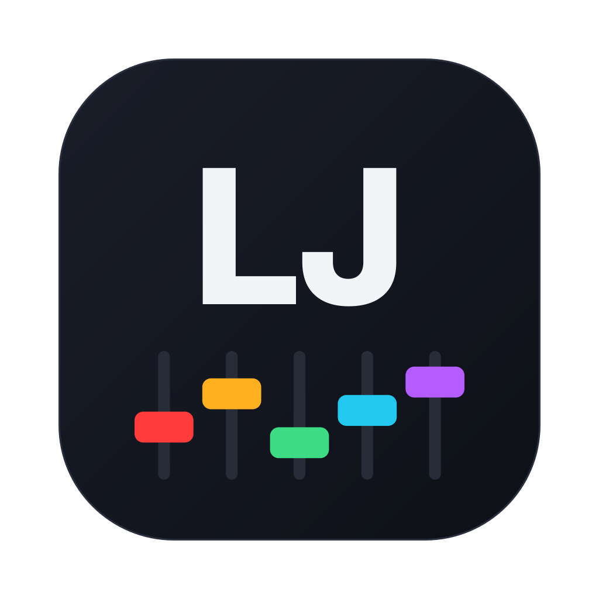</a>

**[LJ Link](https://github.com/skyplayser/LJ-Link)** shows the lighting jockey what the DJ plays: every deck, waveform,
cue and the BPM from Pioneer and Denon gear, and sends the tempo to grandMA, Daslight and more. Free for macOS and
Windows.

<br clear="left">

<a href="https://github.com/skyplayser/LJL-Link">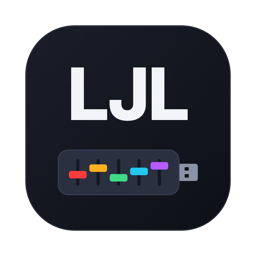</a>

**[LJL Link](https://github.com/skyplayser/LJL-Link)** brings the Serato decks of the DJ's Mac into LJ Link – straight
from the club's USB stick, nothing to install. Alpha for macOS.

<br clear="left">

<a href="https://github.com/skyplayser/VJ-LINK">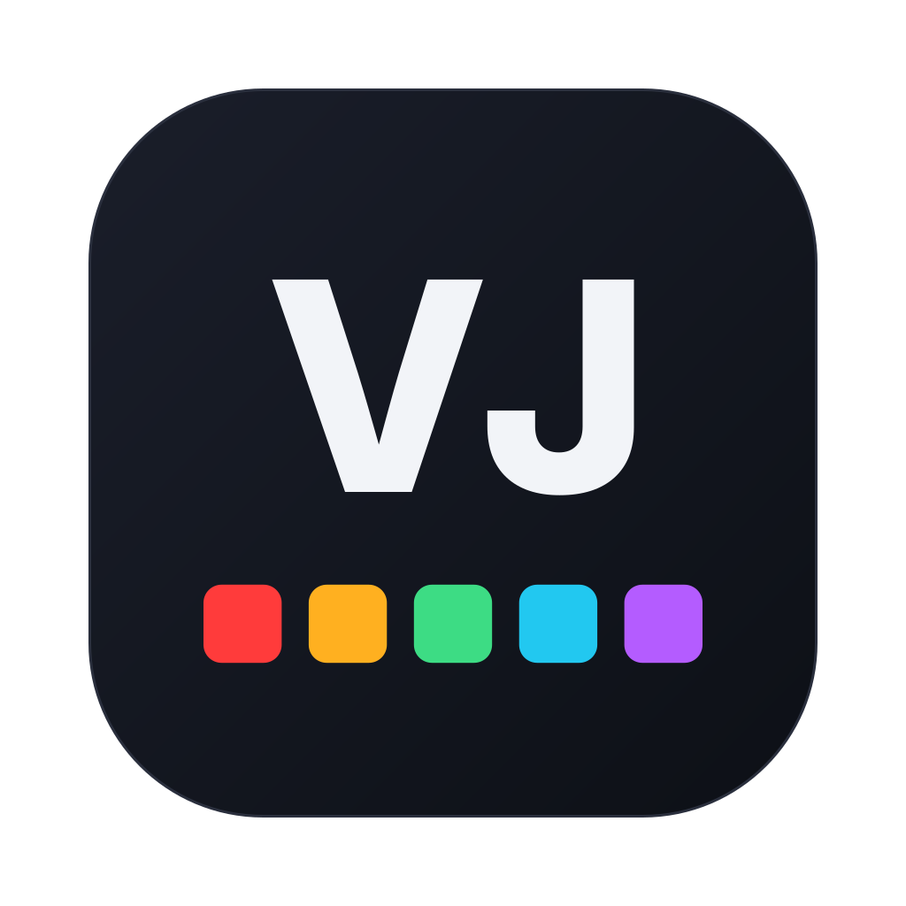</a>

**[VJ-Link](https://github.com/skyplayser/VJ-LINK)** plays live visuals run by the light desk, on screens, LED walls and
projectors, and takes tempo and track from LJ Link. Free for macOS and Windows.

<br clear="left">

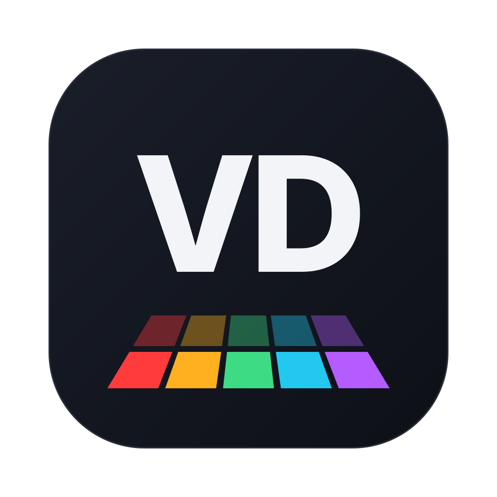

**VD-Link** (coming soon) is a 3D light visualizer for Art-Net and sACN: your light desk runs a
virtual club or festival, and you see the show before it is hung. Beta.

<br clear="left">

**In the works:** PL Link (patch and power load for venues), NET Link (who is in the show network and what is wrong with
it) and dB Link (sound level: measure, warn, log). Not released yet.

## Build from source

Crew Link is an Electron app in TypeScript, licence **EPL-2.0**. State: **0.1.0 = MVP (phase 1 of the concept)**.
Design patterns: [`design/`](design/).

### Start

Node 22 or newer.

```sh
npm install
npm run check          # type check + tests (vitest)
npm run build          # build to dist/
npm start              # build and start
npm start -- --demo    # with demo event (two days, three floors, relative to the current time)
```

If `npm install` does not fetch the Electron program, `npm start` fetches it once on the first start.

#### Start options

| Option | Effect |
|---|---|
| `--demo` | Demo “Weekend Club Example” (in German: “Wochenende Club Beispiel”): on Main a set is running (a good 10 min left, Kira ready), in the Keller a set runs over, the terrace is past its floor end, curfew in about 2 h. Saves nothing. |
| `--web-on` | switch the web interface on right away (off by default). |
| `--port <n>` | port of the web interface for the demo (default 8070). |
| `--lang de\|en` | force the language. |
| `--no-intro`, `--no-anim` | without start animation. |
| `--intro=<ms>[,<ms>…]` | only with `--shot` (which otherwise never shows an animation): picture sequence of the start animation (stills via the `holdAt` option of the shared module), night and day, plus “reduce motion”, the end state and the landing in the header logo when the start screen is switched off; then quit. Alias: `--intro-at <ms,…>`. Example: `--shot shots/intro --intro=400,1000,1500,1900,2300,2600` |
| `--hint` | show the “Get Link-Suite” card also in demo/screenshots. |
| `--launcher=installed\|missing` | only with `--shot`: pretend the launcher is (not) installed. |
| `--help` | list the start options. |
| `--shot-address <ip>` | only with `--shot` or `--demo`: shows this IPv4 address on the start screen, ROLES and QR codes instead of the real one (for published pictures). The server still binds for real. |
| `--shot <folder>` | screenshots for QA, then quit (see below). Switches on demo and web interface itself. |

| Environment | Effect |
|---|---|
| `CREWLINK_DATA=<folder>` | own data folder (tests, QA). Then several instances are allowed and the suite network runs on the **test port 47681**. |
| `CREWLINK_SUITE_PORT=<n>` | force the port of the suite network (real room: 47676). |
| `CREWLINK_DEBUG=1` | console messages of the interface in the terminal. |

#### Screenshots for QA

```sh
npm run build
CREWLINK_DATA=/tmp/crew-qa npx electron . --demo --web-on --shot /tmp/crew-shots
```

Makes 68 PNGs (each German/English × night/day): start screen, TIMETABLE (Nova selected), NOW, ROLES, CONNECT, window
“Big clock” for Main and Keller, and the browser pages over `http://127.0.0.1:<port>`: choose role, lead, booth Keller,
DJ Kira, tech, security, bar (390 × 844), big clock Main/Keller and public page (1280 × 720). List in `LISTE.txt` in the
folder. The suite network runs on the test port 47681.

With `--demo --web-on` the web interface of the demo is at `http://127.0.0.1:8070/` (or `--port`): `/`, `/r/leitung`,
`/r/booth/keller`, `/r/dj/kira`, `/r/technik`, `/r/security`, `/r/bar`, `/uhr/main`, `/oeffentlich`,
`/oeffentlich?floor=main`; appearance with `?theme=day|night`, language with `?lang=de|en`.

### Structure

| Folder | Content |
|---|---|
| `src/core/` | no Electron, no network, fully tested: `zeit.ts` (time zone with `Intl` only), `model.ts` (event, days, floors/stages, slots, `.crewlink` file, templates), `countdown.ts` (running day, floor state, countdown states, curfew sequence), `check.ts` (check), `shift.ts` (“Shorten next”, “Shift everything” as preview), `clock.ts` (house clock for control desk and browser), `plan.ts` (filtered plan per role, notices), `net.ts` (web server checks, `suite:"crew"` here/tick), `demo.ts`, `suitechat.ts` (from VJ-Link), `i18n*.ts` |
| `src/main/` | main process: `main.ts` (windows, IPC, house clock, start options), `webserver.ts` (port 8070, `node:http` + `ws`), `suitenet.ts` (adapter with the interface of suite-net), `chatnet.ts` (suite chat), `storage.ts` (saving only with consent), `shots.ts` (QA), `preload.ts` (narrow bridge) |
| `src/renderer/` | control desk: start, NOW, TIMETABLE (timeline, list, detail column), CLOCK, ROLES, SIGNALS, CONNECT, dialogs, print, chat, lock mode; `clock.ts` = window “Big clock” |
| `src/web/` | browser pages (one page that reads the path): roles, big clock, public page; `awake.ts` + `keep-awake-video.js` from LJ Link |
| `src/shared/` | shared by control desk and browser: styles (`design/tokens.css`, `components.css` + `app.css`), icons, big clock, notice texts |
| `assets/` | logos, font (OFL), `intro/startanimation.html` (shared building block of the suite) |
| `tests/` | vitest: time (13 hand-checked cases + cross-check with temporal-polyfill 2026–2030), core, i18n, network (suite network only on port 47681, web server, saving) |

### Handover and running over

- Per event “Handover: as planned” (default) or “confirm” (demo). With “confirm” a directly following slot only starts
  with **Handover now**; until then the previous one keeps counting with “+mm:ss”. Without confirmation the plan applies
  again at the latest from the earliest of: end of the next slot, floor end and curfew; from +15 min lead and booth get
  the notice “Confirm handover?”. `tick` and the public page follow this.
- “Shorten next” / “Shift everything” show a preview and only change after “Confirm” – with “confirm” only the following
  slots (start = confirmed or expected handover); the planned end of the overrun slot stays, the actual handover is stored
  separately in the slot (`handover`).
- Clock change: a time in the missing hour is rejected when typed. When copying a day and with templates every slot is
  kept: start at the first valid time after it, same length, yellow check card “Time fell into the clock change –
  checked?”.

### Data and privacy

- Without consent (“Save on this computer?” = No) Crew Link does not write the event to disk – no autosave, no list of
  recently opened files. The demo never saves.
- With consent: running backup as `.crewlink` (atomic), file freely chosen (“Save as …”), otherwise in the data folder
  under `veranstaltungen/<id>.crewlink`; it is opened again on the next start.
- `prefs.json` in the data folder is only created when a setting differs from the default (language, appearance, start
  screen, start animation, suite network) or – only with consent – to remember the path of the last saved event. Without
  a change there is no `prefs.json`. Electron/Chromium creates its own cache files in the data folder (without names from
  the plan).
- An event opened by hand (“Open event”) that was saved with the web interface on never switches it on by itself: Crew
  Link asks (“Switch on web interface?”). The own last saved event reopened at start (e.g. after a crash) switches it on
  again without asking, so phones and clocks come back right away.
- `running.lock` in the data folder: created at start, deleted on a clean quit (only process number and time, no
  names). If it is already there at start, the last run crashed → no start animation.
- Start animation: shared module “Programm-Intro” from the Suite-Launcher (`src/renderer/intro/`, unchanged). The own
  switch (Settings: Like the suite / On / Off, stored as `own.intro`) wins; otherwise `intro` from `Link-Suite/suite.json`
  applies (read only). Once per program start; never in the big clock or the browser pages.
- Browser pages store nothing (no cookies, no localStorage). Name/position in the suite chat only in memory.

### Security (phase 1)

- **No PIN in phase 1:** whoever reaches port 8070 can open every role, also `/r/leitung` with internal names (secret
  guests) and notes. The PINs are already assigned (file, printout for the lead) but only checked from phase 2.2. So:
  share the web interface only in the show network or a separate crew Wi-Fi, never in the guest Wi-Fi.
- Big clock (`/uhr/…` and window) and `/oeffentlich` get only public names and no notes; the public page only the shown
  and the following day, no handover times and no notice settings.
- Everything in the show network is unencrypted (no HTTPS). Per WebSocket at most 64 KB per message and 20 `ping` in
  10 s.
- Two control desks in the network: Crew Link listens for other `here` with `role:"lead"` and warns in the header and
  under CONNECT; whoever was there first counts.

### Still open

- **Stages** (festival, concept 1.1): in the data model and the file, but without an interface to create and assign them
  – belongs to phase 5.5 (festival extras).
- Signing and notarization, test on Windows (phase 5.6), test on real phones and tablets.
  The program icon (`assets/icon.png`) is set for windows and dock.
- PINs and rights, crew chat page, Bonjour `_crewlink._tcp` (phase 2); log of the night (phase 3, only the consent is
  remembered); signals, house light, timecode (phase 4); own countdowns, offline copy in the browser, CSV import.

### Network

- Web interface: port 8070, off by default; port taken → message with the program that holds it (macOS, if it can be
  found); only source addresses from 10/8, 172.16/12, 192.168/16, 169.254/16, 127/8; host and origin check; only
  GET/HEAD; fixed file table; CSP without outside sources; no fallback port. Phase 1: all pages read only.
- Suite network: multicast 239.255.76.76:47676, TTL 1, all IPv4 adapters, `reuseAddr`. Sends `here` (every 5 s, with
  `ver`), `tick` (every second, only public names, only the running day), `bye`; answers `probe` with `echo`. On by
  default, can be switched off under CONNECT.

Changes per version: [CHANGELOG.md](CHANGELOG.md). Third-party parts and their licences: [THIRD_PARTY.md](THIRD_PARTY.md).

## Credits and notices

Big digits and logo lettering: [Inter](https://github.com/rsms/inter) (SIL Open Font License 1.1, see
[assets/fonts/Inter-OFL.txt](assets/fonts/Inter-OFL.txt)). QR codes with uqr (MIT), WebSocket with ws (MIT), built on
Electron (MIT). Shared code from VJ-Link and LJ Link (same author, EPL-2.0). Details in [THIRD_PARTY.md](THIRD_PARTY.md).

Crew Link is an independent project. It is not an official product of, and is not endorsed by, AlphaTheta / Pioneer DJ,
inMusic / Denon DJ, Serato, MA Lighting, Daslight, Artistic Licence or any other maker of DJ, lighting or event hardware
or software, nor of Apple, Google or Microsoft. Apple, macOS, iPhone, iPad and Bonjour are trademarks of Apple Inc.; CDJ is a trademark of AlphaTheta Corporation; Android is a
trademark of Google LLC; Windows is a trademark of Microsoft Corporation. All product names and trademarks belong to their
owners and are used only to describe compatibility. Art-Net™ Designed by and Copyright Artistic Licence Holdings Ltd. Crew Link is not related to the LightJockey software by
Martin.

Crew Link is free and comes without warranty. It is not an alarm or safety system. Keep a printed timetable as a
fallback.

## License

© 2026 Philipp Spruck / NEXTPHILM. Crew Link is distributed under the [Eclipse Public License 2.0](LICENSE), without any
warranty. Note for Germany: „Die Haftung nach den gesetzlichen Vorschriften für Vorsatz und grobe Fahrlässigkeit, für
Verletzungen von Leben, Körper oder Gesundheit und nach dem Produkthaftungsgesetz bleibt unberührt.“

<br>

<p align="center">
  <sub>Idea SKYPLAYSER/NEXTPHILM<br>
  Prompted with ❤️ made by Claude<br>
  <a href="https://skyplayser.github.io/Crew-Link/impressum.html">Legal notice (Impressum)</a> ·
  <a href="https://skyplayser.github.io/Crew-Link/datenschutz.html">Privacy policy</a></sub>
</p>
